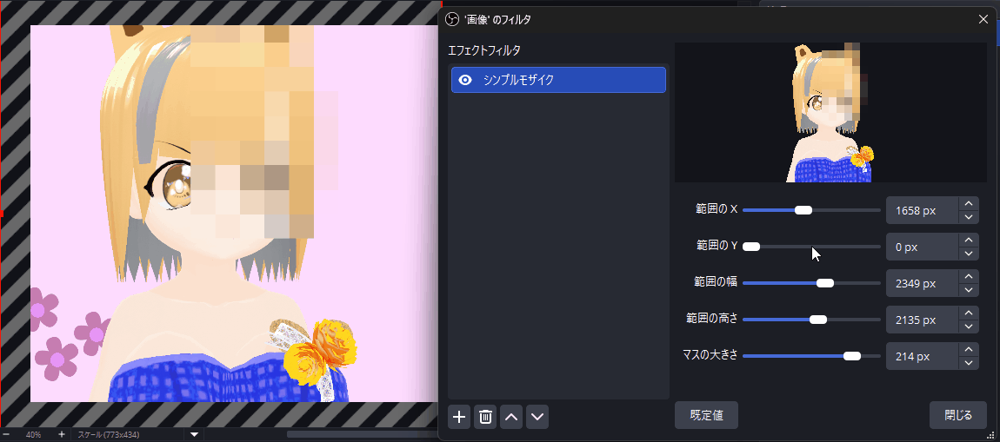

# Simple Mosaic Plugin for OBS Studio

OBS Studio 向けの、四角形の範囲をモザイクにするシンプルな映像フィルターのプラグインです。

A simple video filter plugin for OBS Studio that pixelates a rectangular region.

[配信プラグイン倉庫くん](https://soko-kun.allegromoltov.jp/plugins/allegromoltov/obs-simple-mosaic) にも掲載しています。 / Also listed on [Plugin Soko-kun](https://soko-kun.allegromoltov.jp/plugins/allegromoltov/obs-simple-mosaic?lang=en).



## Features / 機能

ソースやグループに付ける映像フィルターです。範囲 (X・Y・幅・高さ) とマスの大きさを px で決めるだけで、範囲の中をモザイクにできます。範囲の外は元の映像のまま通します。マスの色はマスの中の画素の平均で、細かい模様が動いてもちらつきにくくしています。描画はすべて GPU のシェーダーで行い、1920×1080 の全体にかけたときの GPU 時間は 1 フレームあたり約 0.04〜0.06 ms です (RTX 3060 Ti で測定)。

A video filter for sources and groups. Set the region (X, Y, width, height) and the cell size in pixels, and the region is pixelated while the rest of the image passes through unchanged. Each cell is filled with the average of its pixels, which reduces flicker on fine moving patterns. All drawing runs in GPU shaders and takes about 0.04–0.06 ms of GPU time per frame when the whole 1920×1080 image is pixelated (measured on an RTX 3060 Ti).

- **Region X / Y・範囲の X・Y** - 範囲の左上の位置
- **Region Width / Height・範囲の幅・高さ** - 範囲の大きさ
- **Cell Size・マスの大きさ** - モザイクの 1 マスの一辺

## Installation / インストール

### Windows

Windows 版は OBS Studio 33 以降向けです。OBS Studio 33.0.1 で、導入、フィルターの追加、ソースとグループへの適用を確認しています。

#### 通常版 OBS への導入

プラグインを OBS Studio の共通プラグインフォルダーへ配置します。

1. OBS Studio を終了してください。
2. [Releases](../../releases) から Windows 用の zip ファイルをダウンロードし、展開してください。
3. エクスプローラーのアドレスバーへ `%PROGRAMDATA%` を入力し、Enter キーを押してください。隠しフォルダーの表示設定を変更する必要はありません。
4. `obs-studio` フォルダーを開き、その中の `plugins` フォルダーを開いてください。存在しないフォルダーは順に作成してください。
5. 展開した `simple-mosaic` フォルダーを `plugins` へコピーしてください。管理者の許可を求められた場合は許可してください。
6. OBS Studio を起動し、ソースのフィルターからシンプルモザイクを追加してください。

導入後の構成を次に示します。`simple-mosaic` フォルダーを二重に作らないでください。PDB ファイルが同梱されている場合も、製品フォルダーごとコピーします。

```text
%PROGRAMDATA%\obs-studio\plugins\
└─ simple-mosaic\
   ├─ simple-mosaic.dll
   └─ data\
      ├─ effects\mosaic.effect
      └─ locale\
         ├─ en-US.ini
         └─ ja-JP.ini
```

更新するときは、OBS Studio を終了し、同じ手順で `simple-mosaic` フォルダーを上書きコピーしてください。設定やシーンは削除しないでください。

#### ポータブル版 OBS

ポータブル版では、OBS Studio のルートフォルダーにある `plugins` へ製品フォルダーをコピーします。通常版の `%PROGRAMDATA%` への導入では読み込まれません。

OBS Studio を終了し、`bin` や `data` と同じ階層に `plugins` フォルダーを作成してください。展開した製品フォルダーをコピーし、`plugins\simple-mosaic\simple-mosaic.dll` と `plugins\simple-mosaic\data` を配置してから OBS Studio を起動します。

### macOS / Linux

macOS / Linux 向けのビルドは GitHub Actions で生成しています。GitHub Actions 上の Ubuntu 24.04 (Mesa の OpenGL) と macOS 15 (OpenGL) で、モザイクの描画を自動で検証しています。作者は macOS と Linux の実機を持たないため、実機の GPU と OBS Studio では動作を確認していません。macOS の OBS Studio 32 以降で選べる試験的な Metal 描画も確認していません。ソースからのビルドは「Build / ビルド」を参照してください。

## Usage / 使い方

1. モザイクにしたいソースかグループを右クリック → **フィルター** を開く
2. 映像フィルターの **+** ボタン → **Simple Mosaic** (または **シンプルモザイク**) を追加
3. 付けた直後は全体がモザイクになるため、範囲の X・Y・幅・高さで隠したい場所に狭める
4. マスの大きさで粗さを調整する

複数のレイヤーをまとめてモザイクにするには、それらをグループにまとめ、グループにフィルターを付けます。グループの外に置いたレイヤーには、モザイクがかかりません。

To pixelate several layers at once, put them in a group and add the filter to the group. Layers outside the group are not pixelated.

## Parameters / パラメータ

| Parameter | 日本語 | Range | Default |
|-----------|--------|-------|---------|
| Region X / Y | 範囲の X・Y | 0 ~ 対象の幅・高さ (px) | 0 |
| Region Width / Height | 範囲の幅・高さ | 0 ~ 対象の幅・高さ (px) | 対象の幅・高さ |
| Cell Size | マスの大きさ | 2 ~ 256 px | 16 px |

範囲の位置は、フィルターを付けた対象の左上からの px です。幅か高さが 0 のときは、何もかけません。

The region position is measured in pixels from the top-left corner of the filtered source. If the width or height is 0, nothing is pixelated.

## Known Behavior / 既知の挙動

- 範囲は、フィルターが対象の大きさを初めて取得できた時点で、対象の全体に設定されます。映像キャプチャデバイスのように止まっている間は大きさが 0 のソースでは、映像が届いた時点で全体になります。
- 範囲は px のまま保たれます。キャンバスの解像度の変更などで対象の大きさが変わっても範囲は追従せず、対象からはみ出した部分は内側だけにかかります。
- スライダーの上限は、設定画面を開いた時点の対象の幅と高さです。対象の大きさが分からないときは 8192 px です。
- 範囲の枠は描きません。モザイクの境目で範囲を確かめてください。フィルターが描いたものは配信の映像にも映ります。また、プレビューにだけ枠を描く公開の仕組みが OBS Studio にはありません。
- マスの区切りは範囲の左上を起点にします。範囲の右端と下端で欠けたマスは、欠けた大きさの中で平均します。
- 半透明の画素を含むマスは、透明度を含めて平均します。透明な部分が混ざったマスは半透明になります。

## Build / ビルド

### Requirements / 必要環境

| Platform | Tool |
|----------|------|
| Windows | Visual Studio 17 2022 |
| Windows | CMake 3.28+ |
| macOS | Xcode 16.0, CMake 3.28+ |
| Ubuntu 24.04 | ninja-build, pkg-config, build-essential, CMake 3.28+ |

### Build Commands / ビルドコマンド

```bash
# Windows
cmake --preset windows-x64 -DENABLE_POST_BUILD_INSTALL=OFF
cmake --build build_x64 --config RelWithDebInfo

# macOS
cmake --preset macos
cmake --build build_macos --config RelWithDebInfo

# Ubuntu
cmake --preset ubuntu-x86_64
cmake --build build_x86_64 --config RelWithDebInfo
```

Windows で生成物を取り出すには、`cmake --install build_x64 --config RelWithDebInfo --prefix release/RelWithDebInfo` を実行してください。生成した製品フォルダーを前述の手順で導入してください。

Windows では、描画の統合テストを Direct3D 11 と OpenGL の両方で CTest に登録しています。OBS のグラフィックスの DLL を `cmake --build .deps/obs-studio-31.1.1/build_x64 --config Release --target libobs-d3d11 libobs-opengl` で作ってから、`ctest --test-dir build_x64 -C RelWithDebInfo` を実行してください。

## AI利用開示 / AI Disclosure

### 日本語

v1.0.0 の制作では、Anthropic Claude Code を、調査、ソースコード、ビルド設定、テスト、文書を含むほぼすべての工程で使用しました。リソースアイコンは、Claude Code が作成したスクリプトで生成した SVG の案から、作者本人が選びました。

作者本人は Windows 上の OBS Studio でユーザーテストを実施しました。コード読解による厳密な人間レビューは実施していません。概要説明欄のアニメーション GIF は、作者本人が ScreenToGif で画面収録したもので、生成 AI を使用していません。

### English

Anthropic Claude Code was used for almost the entire development process of v1.0.0, including research, source code, build configuration, tests, and documentation. The resource icon was chosen by the author from SVG candidates generated by a script that Claude Code wrote.

The author performed user testing in OBS Studio on Windows but did not perform a rigorous human review of the source code. The animated GIF in the description was screen-recorded by the author using ScreenToGif, without generative AI.

## License / ライセンス

GPL-2.0 License

このプラグインは [obs-plugintemplate](https://github.com/obsproject/obs-plugintemplate) をベースにしています。

## Author / 作者

AllegroMoltoV - https://www.allegromoltov.jp

## Changelog / 更新情報

### v1.0.1 (2026-11-13)

- リリースの配布物にビルドの来歴の証明 (GitHub Artifact Attestation) を付けるようにしました。プラグインの動作は v1.0.0 と同じです。

### v1.0.0 (2026-11-11)

- 最初の公開版です。
